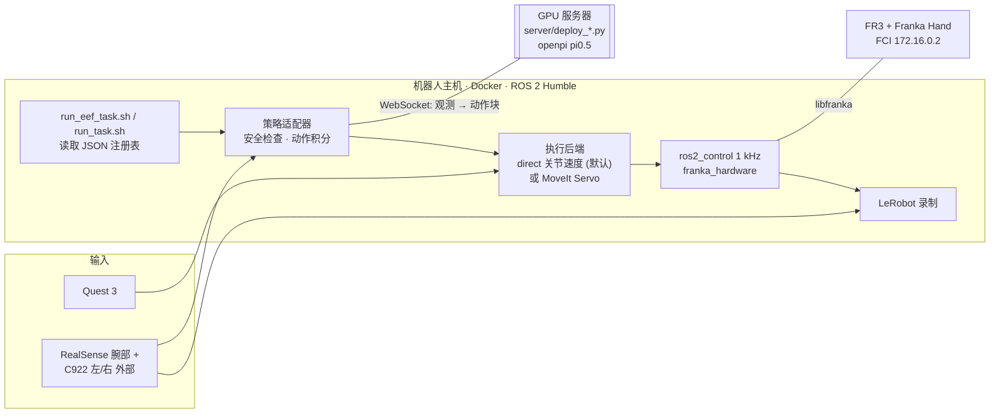

# Franka VR Docker

在 Franka FR3 上做 **VR 遥操作采集 → VLA 训练 → 真机部署** 的 Docker 化 ROS 2 工程。机器人主机运行 ROS 2 Humble、MoveIt 2、ros2_control 和 libfranka。VLA 模型（Qwen-VL + ActionCodec 的 EEF 位姿模型，以及 openpi pi0.5 关节速度模型）运行在内网 GPU 服务器上，通过 WebSocket 与机器人主机交换观测和动作。

> [!WARNING]
> 本项目不是经过安全认证的机器人控制系统。真机运行前必须完成 Franka 官方要求的安装、网络和实时性检查；保持急停可用，确保工作区无人。首次测试应低速、无负载进行。

> **Agent 请先读 [AGENTS.md](AGENTS.md)**：其中写明了哪些命令可以安全执行、怎样增量修改本项目。

## 架构一览



完整的部署图、ROS 话题图、三条控制链路、推理时序和安全层见 **[docs/architecture.md](docs/architecture.md)**。

## 快速上手

### 跑一个 VLA 任务（当前主流程：EEF 位姿模型）

```bash
./fci_init.sh                                  # 上电后初始化：夹爪 + 回初始位（会动）
./run_eef_task.sh list                         # 有哪些任务和模型（离线）
./run_eef_task.sh task1 act-v2 show            # 本次实际生效的配置（离线）
./run_eef_task.sh task1 act-v2 dry-run         # 启动服务 + 相机 + 推理，不发运动
./run_eef_task.sh task1 act-v2 axis-test +z    # direct 后端首次使用：逐轴小步自检
./run_eef_task.sh task1 act-v2 run             # 真机执行
./run_eef_task.sh task1 act-v2 stop            # 停止 + 夹爪 homing + 回初始位
```

`task1-act-v2.sh` 等是上面命令的快捷方式。各模式的细节见 [docs/guides/eef_task_launcher.md](docs/guides/eef_task_launcher.md)。

### 换权重 / 加任务

**只改 JSON，不改 shell。**

| 动作协议 | 注册表 | 入口 |
| --- | --- | --- |
| EEF 位姿 15×7（主流程） | [`config/eef_tasks.json`](config/eef_tasks.json) | `./run_eef_task.sh <task> <model> …` |
| pi0.5 关节速度 | [`vla_instruction_weights.json`](vla_instruction_weights.json) | `./run_task.sh <id> …` / `task1.sh` |

```bash
python3 scripts/validate_task_registries.py    # 改完先离线校验
./run_eef_task.sh <task> <model> show          # 再看合并结果
```

字段说明、增量扩展步骤、当前模型速查表：**[docs/weights_and_tasks.md](docs/weights_and_tasks.md)**。

### 遥操作与采集示教数据

```bash
ROBOT_IP=172.16.0.2 ./run_robot.sh             # 终端 1：真机 Servo 栈
./run_vr.sh                                    # 终端 2：Quest 3（右扳机跟随，右握键控制夹爪）
./run_lerobot_record.sh <数据集> <秒数> "<任务描述>"   # 终端 3：录制，Quest A 键保存
```

录制保存时会自动核验夹爪标签，不通过会报 ERROR 并写入 `episodes.jsonl`。夹爪宽度异常时先执行 `./homing.sh`。仿真（`./run_gazebo.sh`）、键盘控制、RealSense 等操作见 [docs/guides/teleop_sim_recording.md](docs/guides/teleop_sim_recording.md)。

### 首次部署

```bash
cp .env.example .env                           # ROBOT_IP / ROS_DOMAIN_ID / DISPLAY
xhost +local:docker                            # 需要 RViz/Gazebo 时
docker compose build
./configure_fci_realtime_host.sh               # 一次性：实时 CPU 与 FCI 网卡中断（脚本自行提权），完成后重启
```

源码以卷挂载进容器，启动脚本每次都会重新编译 `franka_vr`。只有 Dockerfile、系统依赖或上游源码变化时才需要重新 `docker compose build`。

## 目录结构

| 位置 | 内容 |
| --- | --- |
| 根目录 `*.sh` | 启动入口，分类与状态见 [docs/scripts.md](docs/scripts.md) |
| `config/` | `eef_tasks.json`（EEF 注册表）、`default_initial_pose.json`（`fci_init.sh` 回位目标）、`sysctl/` |
| `vla_instruction_weights.json` | pi0.5 关节注册表 |
| `server/` | GPU 服务器上运行的 EEF 模型服务（由 `run_eef_pose.sh server` 自动 scp 过去）与轨迹回放服务 |
| `scripts/` | 注册表解析与校验、离线测试 `test_*.py`、诊断工具；`data_fix/` 数据清洗；`offline_eval/` 离线评估 |
| `workspace/src/franka_vr/` | **本项目自研 ROS 2 包**：适配器、执行器、控制器插件、launch、标定参数 |
| `workspace/src/` 其余包 | 上游源码快照：franka_ros2、franka_description、moveit2 等 |
| `calibration/` | 相机内参、外参与 Isaac Sim 相机对齐包 |
| `docker/`、`Dockerfile*`、`docker-compose*.yml` | 镜像与容器配置（CPU 隔离、实时优先级） |
| `vendor/`、`upstream-libfranka-docker/` | libfranka 0.19 及上游 Docker 资源 |
| `docs/` | 文档，索引见 [docs/README.md](docs/README.md) |

`logs/`、`validation_logs/`、`datasets/` 是机器人主机上的本地运行产物，不纳入 git。默认日志目录是 `FRANKA_LOG_ROOT=/media/mac/Elements1/franka_vr_docker/logs`。

## 文档

| 想做什么 | 看哪里 |
| --- | --- |
| 理解整体架构 | [docs/architecture.md](docs/architecture.md) |
| 配置权重、加任务 | [docs/weights_and_tasks.md](docs/weights_and_tasks.md) |
| 跑 EEF 任务的各模式 | [docs/guides/eef_task_launcher.md](docs/guides/eef_task_launcher.md) |
| 遥操作、仿真、采集 | [docs/guides/teleop_sim_recording.md](docs/guides/teleop_sim_recording.md) |
| 出问题了 | [docs/guides/troubleshooting.md](docs/guides/troubleshooting.md) |
| 找某个脚本 | [docs/scripts.md](docs/scripts.md) |
| 补基础知识（坐标系、旋转、控制、VLA） | [docs/reference/robot_vla_basics.md](docs/reference/robot_vla_basics.md) |
| 历史问题与实验结论 | [docs/reports/](docs/reports/) |

## 致谢与许可证

本项目建立在 [Franka ROS 2](https://github.com/frankaemika/franka_ros2)、[libfranka](https://github.com/frankaemika/libfranka)、[MoveIt 2](https://moveit.ai/) / MoveIt Servo 和 [Oculus Reader](https://github.com/rail-berkeley/oculus_reader) 之上。自有代码采用 [MIT License](LICENSE)；仓库中的上游组件仍分别遵循其原有许可证和使用条款。
