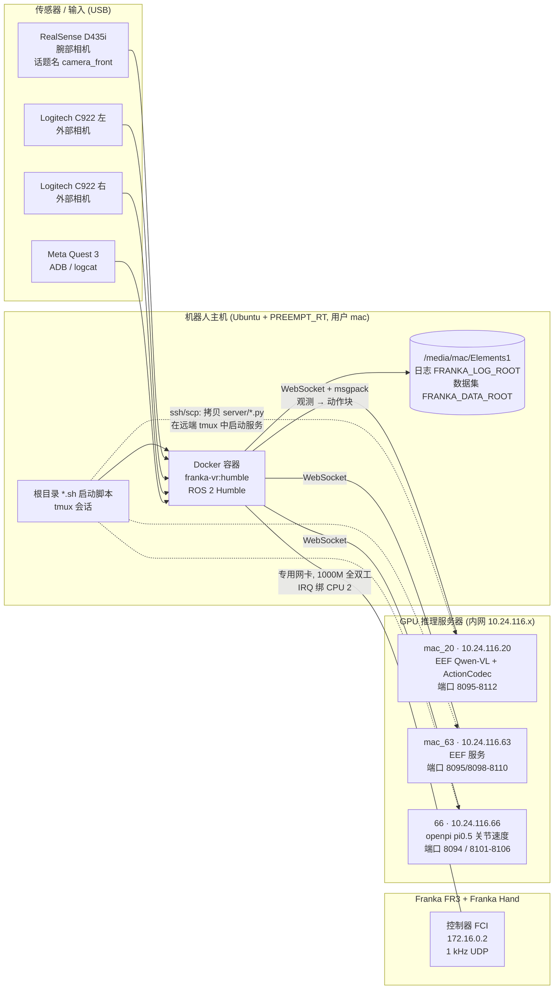
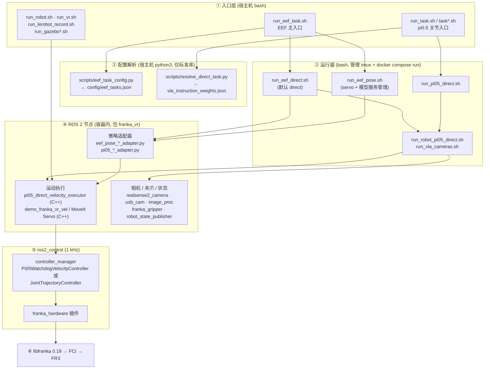
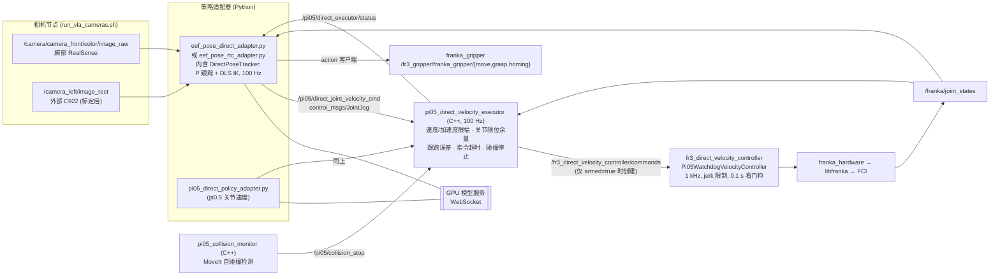
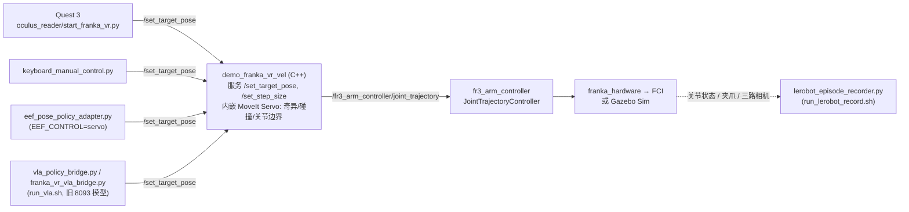
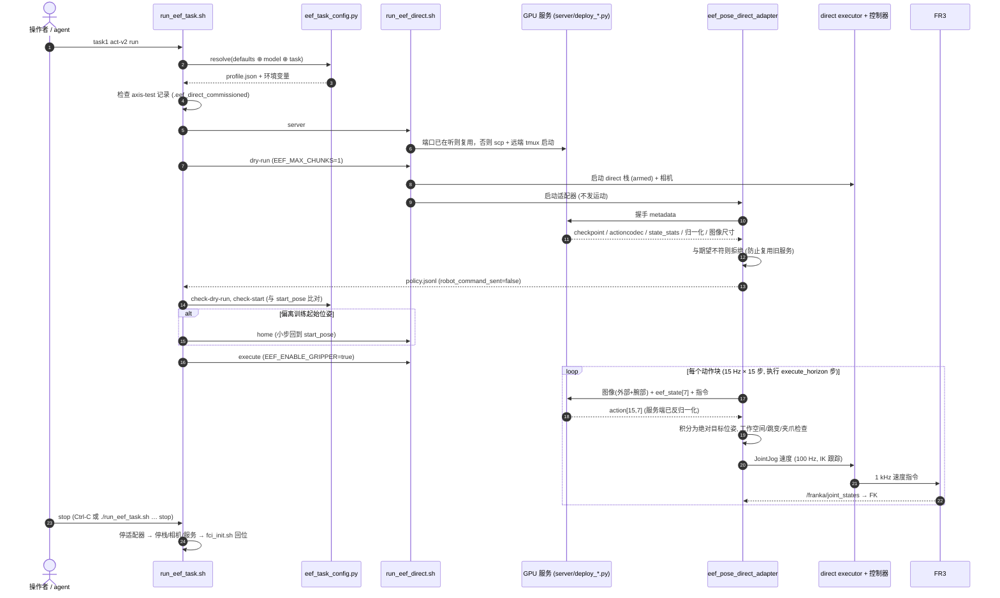
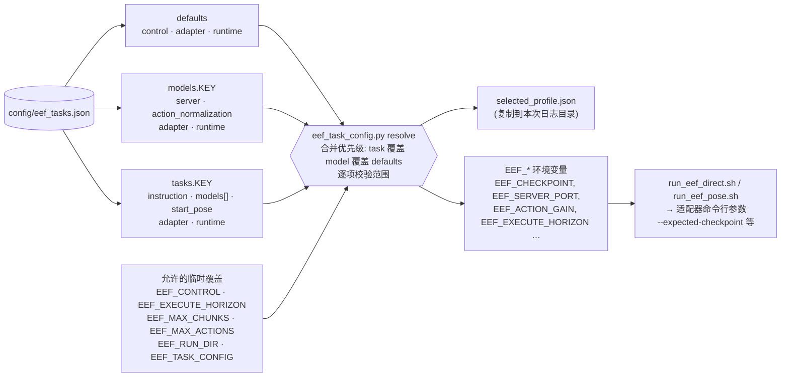
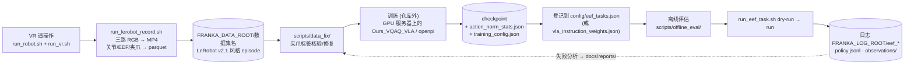

# 系统架构

本文从硬件、网络一直讲到 ROS 2 节点、控制器和 libfranka，说明一条 VLA 动作是怎么变成 FR3 关节运动的。
图用 Mermaid 写成，GitHub、VS Code 预览、Typora 都能直接渲染；纯文本阅读时节点名与话题名同样可检索。

> 写于 2026-11-13，对应分支 `feat/eef-pose-control`，提交 `ecdd8d3`。若代码中的话题名、端口与本文不一致，以代码为准，并顺手更新本文。

## 目录

1. [物理部署与网络](#1-物理部署与网络)
2. [软件分层](#2-软件分层)
3. [三条控制链路](#3-三条控制链路)
4. [EEF 推理闭环（当前主流程）](#4-eef-推理闭环当前主流程)
5. [配置如何变成一次运行](#5-配置如何变成一次运行)
6. [数据闭环：采集 → 训练 → 部署](#6-数据闭环采集--训练--部署)
7. [实时性与 CPU 布局](#7-实时性与-cpu-布局)
8. [模型接口协议](#8-模型接口协议)
9. [安全层一览](#9-安全层一览)

---

## 1. 物理部署与网络

要点：

- **模型永远不在 FCI 网络上运行**。机器人主机只把观测（图像 + 状态 + 指令）发给 GPU 服务器，拿回动作块，所有安全检查都在本机执行。
- EEF 模型的服务端代码在本仓库 [`server/`](../server/)。`run_eef_pose.sh server` 会把对应的 `deploy_*.py` scp 到远端 `~/franka_eef_server/`，在远端 tmux 里启动。pi0.5 服务端在远端 openpi 工程中，由 [`scripts/pi05_checkpoint_server.sh`](../scripts/pi05_checkpoint_server.sh) 经 SSH 启动。
- IP、端口、GPU、SSH 别名都登记在两份注册表里，见 [weights_and_tasks.md](weights_and_tasks.md)。

## 2. 软件分层

| 层 | 位置 | 说明 |
| --- | --- | --- |
| ① 入口 | 根目录 `*.sh` | 人或 agent 直接调用的命令；完整清单见 [scripts.md](scripts.md) |
| ② 配置 | `config/`、`vla_instruction_weights.json`、`scripts/*config*.py` | 把「任务 + 模型」解析成一份 profile 和一组环境变量 |
| ③ 运行器 | `run_eef_*.sh`、`run_pi05_*.sh`、`run_robot_*.sh` | 启停 tmux 会话、`docker compose run` 容器、远端模型服务 |
| ④ 节点 | [`workspace/src/franka_vr/franka_vr/`](../workspace/src/franka_vr/franka_vr/) | 本仓库自研：`scripts/*.py`（Python 节点）、`src/*.cpp`（C++ 节点与控制器插件）、`launch/`、`config/` |
| ⑤ 控制 | `workspace/src/franka_ros2`、`config/fr3_*controllers.yaml` | 上游 franka_ros2 + 自研 `Pi05WatchdogVelocityController` |
| ⑥ 驱动 | `vendor/libfranka*`、Dockerfile | 上游，不要改 |

`workspace/src/` 下除 `franka_vr` 外的包（`franka_ros2`、`franka_description`、`moveit2`、`moveit_msgs`、`joint_state_broadcaster`、`joint_trajectory_controller`）都是上游源码的快照，以普通目录形式纳入仓库。

## 3. 三条控制链路

同一时刻只能运行一条链路：它们都会创建 `ros2_control` 硬件节点并连接 FCI，且共享 host 网络和 `/controller_manager`。

### 3.1 Direct 关节速度链路（EEF 与 pi0.5 的默认执行后端，无 MoveIt Servo）

启动：`run_robot_pi05_direct.sh` → [`franka_pi05_direct_velocity.launch.py`](../workspace/src/franka_vr/franka_vr/launch/franka_pi05_direct_velocity.launch.py)

- 策略状态用 `/franka/joint_states` 的 FR3 正运动学计算，与训练数据一致。TF `world→fr3_link8` 只做交叉校验，因为它约 60 ms 才更新一次，会滞后。
- 未 armed 时执行器不创建硬件指令发布者，所以 `dry-run` 在结构上就发不出运动指令。

### 3.2 MoveIt Servo 位姿链路（VR 遥操作、键盘、数据采集；EEF 的 `servo` 后端）

启动：`run_robot.sh` → [`franka_twist.launch.py`](../workspace/src/franka_vr/franka_vr/launch/franka_twist.launch.py)；仿真版本是 `run_gazebo*.sh` → `gazebo_vr.launch.py`

### 3.3 pi0.5 JointJog via Servo（遗留）

`run_pi05_joint.sh` / `run_robot_pi05_joint.sh` → `franka_pi05_joint_velocity.launch.py`。`pi05_joint_velocity_adapter.py` 发布 `/servo_node/delta_joint_cmds`，再由 MoveIt Servo 转发给 `fr3_arm_controller`。`run_20k.sh`、`run_7k.sh`、`run_sim2real.sh` 仍走这条链路，用于复现旧实验。新工作请用 3.1。

## 4. EEF 推理闭环（当前主流程）

`./run_eef_task.sh <task> <model> run` 的完整时序：

- **serial**（默认）：执行完一个动作块，停稳，再观测、推理。每块之间约有 1 s 停顿。
- **rtc**（模型 key 以 `-rtc` 结尾）：当前动作块还在执行时就发出下一次观测，到达后在 `rtc_blend_steps` 步内平滑交接。只有 direct 后端支持。

## 5. 配置如何变成一次运行

模型身份（权重、端口、指令）只认 JSON。残留在 shell 里的 `EEF_CHECKPOINT` 之类的环境变量会被 JSON 解析结果覆盖。pi0.5 关节链路的解析方式相同，只是换成 `vla_instruction_weights.json` + `resolve_direct_task.py`，并支持 `direct.runtime_from` 继承。

## 6. 数据闭环：采集 → 训练 → 部署

录制时会自动检查夹爪标签（指令宽度与实测宽度是否一致、是否未回零），结果写入 `episodes.jsonl`。背景见 [reports/task3_gripper_label_bug_20261103.md](reports/task3_gripper_label_bug_20261103.md)。

## 7. 实时性与 CPU 布局

| CPU | 用途 | 来源 |
| --- | --- | --- |
| 2 | FCI 网卡中断 | `configure_fci_realtime_host.sh`（GRUB，一次性）+ `run_robot.sh` 运行时绑定 |
| 4, 5 | `franka_robot` 容器（实时控制）。direct 栈中 `ros2_control_node` 用 `taskset -c 4` | `docker-compose.yml`、`docker-compose.pi05.yml`、launch 文件 |
| 0-1, 3, 6-31 | 相机、VR、构建、适配器等非实时负载 | `docker-compose.yml` 的 `franka_vr` 服务 |

FCI 链路推荐 1000 Mb/s 全双工 + PREEMPT_RT，`run_robot.sh` 启动前会报告这些状态。日志盘 `/media/mac/Elements1` 未挂载时，启动脚本会拒绝写日志（`scripts/runtime_log_root.sh`），以免写满系统盘。

## 8. 模型接口协议

### EEF 位姿模型（`config/eef_tasks.json`，15×7）

| 项 | 定义 |
| --- | --- |
| 状态 `eef_state[7]` | `xyz`（m）+ 绝对旋转向量 `rotvec(3)` + 夹爪张开度 `0..1`，坐标系 `world → fr3_link8`，四元数一律 `xyzw` |
| 图像 | 外部相机（默认 `left`，标定后 `image_rect`）+ 腕部 RealSense，480×640 RGB 发给服务端，服务端缩放到 `model_image_size` |
| 动作 `action[15,7]` | 每步 15 Hz：`Δp = linear × 0.075 m`，`Δrotvec = angular × 0.15 rad`，第 7 维为夹爪张开度 |
| 旋转合成 | `relative_rotvec_left_multiply`（world 帧，`R = ΔR·R`）或 `right_multiply`（tool 帧）。平移恒为 world 增量 |
| 反归一化 | **服务端**完成（`task0_maxabs` / `franka_maxabs` / `franka_mulaw` / `franka_quantile` …），客户端只核对服务端声明的方法 |

权威定义在 [`eef_pose_safety.py`](../workspace/src/franka_vr/franka_vr/scripts/eef_pose_safety.py) 的模块注释和 [reference/eef_pose_control_adapter.md](reference/eef_pose_control_adapter.md)。

### pi0.5 关节速度模型（`vla_instruction_weights.json`）

openpi pi0.5-DROID 格式：关节速度动作块，由服务端按 checkpoint 统计反归一化。客户端再按 `0.2 rad × 15 Hz` 换算成物理速度，并受 `runtime.max_joint_velocity/acceleration` 限幅。详见 [`pi05_joint_velocity_safety.py`](../workspace/src/franka_vr/franka_vr/scripts/pi05_joint_velocity_safety.py)。

**两种协议的权重不能混用**：pi0.5 关节权重不能登记成 EEF 模型，反之亦然。

## 9. 安全层一览

从外到内，每一层都可以独立拒绝执行：

1. **入口**：`dry-run` 不 arm；`run` 要求先有 axis-test 记录；运动模式需要内部确认令牌（如 `I_UNDERSTAND_DIRECT_EEF`），由入口脚本自动设置，不要手动绕过。
2. **配置**：`eef_task_config.py` 对增益、步长、视野、夹爪参数做范围校验。
3. **服务握手**：适配器核对 checkpoint、ActionCodec、状态统计、图像尺寸、旋转协议、归一化方法，任何一项不符都拒绝。
4. **适配器**：工作空间边界（`config/eef_workspace_bounds.yaml`）、单步平移/旋转上限、跳变检测、夹爪闭合高度限制、TF 新鲜度。
5. **执行器**（C++，100 Hz）：关节速度/加速度限幅、关节限位余量、跟踪误差软/硬阈值、指令时间戳过期、碰撞停止。
6. **控制器**（1 kHz）：jerk 限制、0.1 s 指令看门狗。
7. **Franka 自身**：反射、急停。

**第 7 层是最后防线，前 6 层都不能替代急停。**
