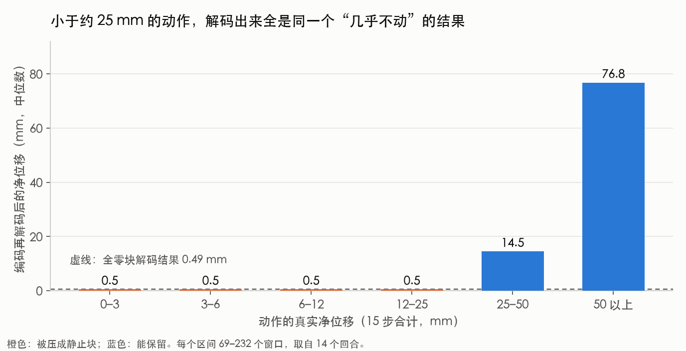
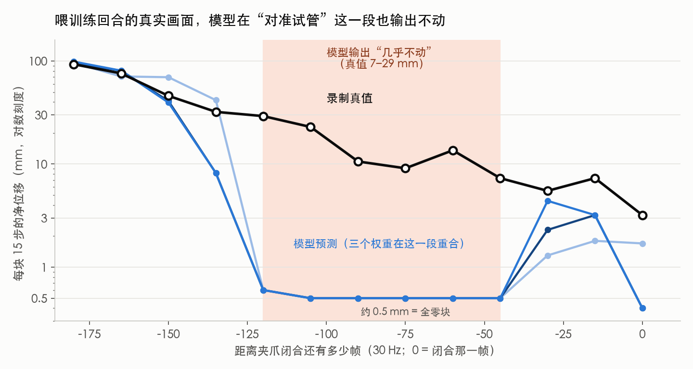
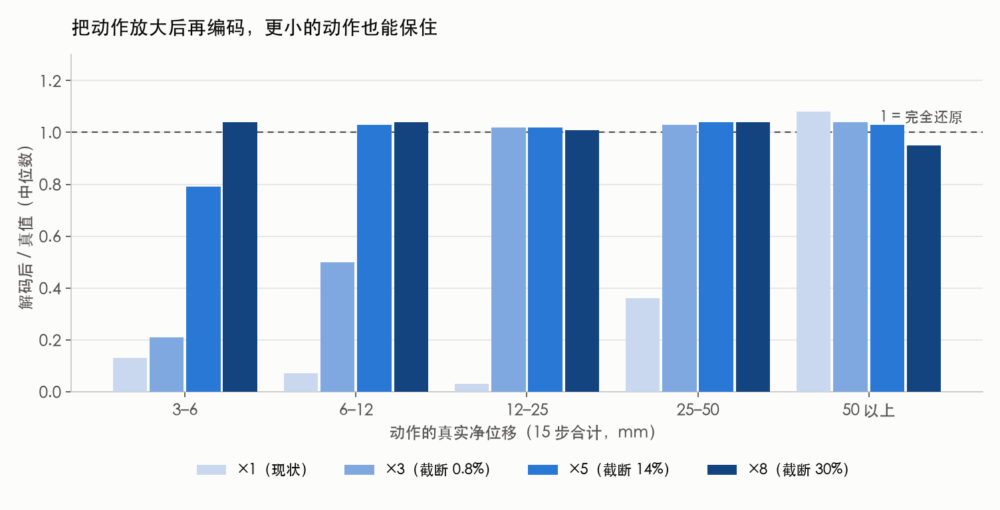
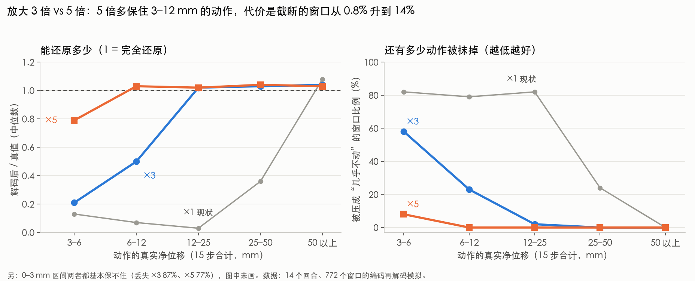

# Task0 v4 模型在试管上方停住、不夹取：实验与结论（2026-10-24）

> **状态更新（2026-10-25）**：按本报告的结论，训练侧已改为放大动作后再编码（`v5_x3`：整体放大 3 倍；`v5_maxabs`：每维最大绝对值），并修了适配器的夹爪处理和 5 步执行问题；用户反馈最新代码在实机上执行成功。版本记录见 [task1_v5_version_record_20261025.md](task1_v5_version_record_20261025.md)。下文是 10-24 的分析原文，其中“还没有验证”的部分已被这次结果部分证实。

## 0. 给不熟悉背景的人：一分钟看懂

**一句话**：模型“看不见”很小的动作，所以机械臂到了试管上方就停住，不会往下夹。

**背景**：我们用演示数据训练一个模型，让机械臂自己把红色试管放进红色篮子。模型每次输出接下来 1 秒的动作（15 小步），机械臂照着执行。

**发生了什么**：机械臂能自己走到试管上方，试管就在两个指尖中间，位置是对的。但它在那里停住不动，夹爪一直张开，等了一分钟也不闭合。

**为什么**：可以把动作编码器想成一把刻度很粗的尺子。
- 这把尺子最小的刻度，相当于机械臂 1 秒大约移动 2.5 厘米。
- 比这更小的动作，尺子都读成“0，没动”。
- 最后对准试管、慢慢下降这一段，每秒只动 0.7 到 2.9 厘米，比刻度还小。
- 训练时，这些动作被尺子记成“没动”。模型学到的就是：到了试管上方，就“不动、不夹”。

**图解：问题出在训练前的“编码”这一步**

```
演示动作（每步几毫米）
        │  ÷ 0.075（换算成尺子上的刻度）
        ▼
┌──────────────────────────────────────────┐
│  动作编码器（那把尺子）                  │
│  整段 15 步一起压成一串码                │
│   · 大动作（净位移 ≳ 25 mm）→ 各有各的码 │
│   · 小动作（净位移 ≲ 25 mm）→ 同一个码   │ ◄── 问题在这里：
│     解码后 ≈ 0.49 mm，等于“没动”         │     对准试管的动作全落在这一档
└──────────────────────────────────────────┘
        │  这些码就是训练标签
        ▼
  模型学习：看到“试管就在指尖中间”→ 输出“静止码”
        │
        ▼
  实机：走到试管上方 → 预测“静止” → 夹爪不闭合 → 状态不变 → 一直静止
```



*图 1：把演示里的真实动作编码再解码，净位移小于约 25 mm 的（橙色），解码结果都是 0.5 mm 左右，和全零动作一样。*



*图 2：喂训练回合的真实画面。夹爪闭合前 120 到 45 帧（粉色区域）是“对准试管并下降”，录制里每块有 7 到 29 mm，模型三个权重都输出约 0.5 mm。纵轴是对数刻度。*

**我们怎么确认的**（不是猜的）：
- 数据处理和机械臂执行都没问题：把录制好的轨迹原样在真机上放一遍，位置和录制的只差 1 到 4 毫米。
- 模型自己的问题：连训练用的原始画面喂给它，到了这一段它也输出“不动”，而且训练 1000 步和 9000 步的模型一模一样，所以多训、换模型都没用。
- 直接证据：把演示里的动作用这把尺子“量一遍再还原”，小于约 25 毫米的动作大部分被还原成“没动”。

**怎么修**：给动作乘一个放大系数，让小动作在尺子上占更多刻度，然后重新训练。推理时再缩回来。


*图 3：纵轴是“解码后 / 真值”，1 表示完全还原，越接近 1 越好。现状（最浅色）在 3 到 25 mm 几乎全丢；放大 3 倍后 12 mm 以上能保住；放大 5 倍后 6 mm 以上能保住。图例括号里是被截断的窗口比例。*



*图 4：只看 ×3 和 ×5（灰线是现状作参照）。左图越接近 1 越好，右图越低越好。×5 在 3 到 12 mm 的小动作上明显更好（3–6 mm 能还原 0.79，×3 只有 0.21；6–12 mm 能还原 1.03，×3 是 0.50），代价是被截断的窗口从 0.8% 升到 14%。两者在 12 mm 以上基本一样。0 到 3 mm 的最细微动作两者都保不住。*

- 放大 3 倍：保住 12 毫米以上的动作，只有 0.8% 的大动作被截断。
- 放大 5 倍：保住 6 毫米以上，14% 的大动作被截断。
- 建议先试 3 倍，不行再试 5 倍。

**为什么放大太多会“截断”**：那把尺子的总长是固定的，只能表示 -1 到 +1 这一段。
- 好比想看清很小的东西，就把它放大；小东西看清了，但大东西会超出尺子的末端，只能读到尺子的最大值。
- 动作放大后送进编码器，超过 ±1 的部分会被直接截成 ±1，这就是“截断”。超出上限的那一步，机械臂会比模型想要的动得少。
- 放大得越多，能读清的动作越小，但“能表示的最大动作”也越小（每步最大位移，按平移三个方向各自的缩放系数算）：

  | 放大倍数 | 每步最大位移 |
  |---|---|
  | ×1（现状） | 约 44 到 59 mm |
  | ×3 | 约 14 到 20 mm |
  | ×5 | 约 9 到 12 mm |

- 实际影响不大：这份数据每步位移的 p99 只有约 10 mm，所以放大 3 倍时只有 0.8% 的窗口里有某一步超限，放大 5 倍时是 14%；被截的是个别快速的步，不是整段动作。
- 所以放大系数是个取舍：越大越能保住最细的动作，也越容易截掉快速的大动作。这是建议先试 3 倍的原因。

**还没验证的**：放大后重新训练能不能真的学会下降并闭合，目前是根据上面的实验推断的，需要重训后才能确认。

## 1. 现象

实机跑 Task0 v4 权重（world 帧、左乘、夹爪 `measured`）时，机械臂能接近试管，但到试管上方后停住不动，夹爪一直保持张开，从不闭合。

| 运行 | 权重 | 现象 |
|---|---|---|
| `task1-act.sh` | save_6000 | 前 8 块几乎不动；第 10 块在离抓取点很远处闭合夹爪，抓空；之后空夹爪走完后半程 |
| `task1-act.sh` | save_9000 | 到 (0.673, -0.161, 0.282) 后停住，约 28 块预测位移为 0，夹爪输出一直是 1.0 |
| `task1-act.sh` | save_5000 | 到 (0.666, -0.178, 0.284) 后停住，约 30 块预测位移为 0；停住时试管就在两个指尖之间 |
| `task1-act-v2.sh`（只执行 5 步） | save_6000 | 90 秒、63 块里基本没离开起点 |

训练里抓取时 z 平均是 0.265，停住时 z 是 0.282，还差约 1.7 cm 没下降。

## 2. 做了哪些实验，各自说明什么

### 实验 1：把录制轨迹在真机上回放（排除数据处理和执行链路）

- 新增 `task1-replay.sh` 和 `replay_eef_trajectory_server.py`：不跑模型，把 `TS_PB_v5_001_cxc` 预处理后的动作块按模型服务的协议发给真机。
- 结果：每块起点的位置和录制的差 1 到 4 mm（z 方向有固定约 +2 mm，来自起点高 1.9 mm）；第 330 帧闭合、第 600 帧张开，和录制同帧；20 块跑完，没有 fault。
- 另外在服务器上做了离线还原：把缓存里的动作按 world 左乘积分回去，与实测 `eef_state` 比对，29 个回合最大位置误差 3.9e-9 m、旋转误差 2.3e-7 rad。
- 结论：预处理、world 左乘、夹爪映射、执行链路都是对的。回放那次没夹到，是试管位置和录制时不同（回放是开环的），不是链路问题。

### 实验 2：演示里闭合前有没有“停顿”（排除模型学了等待）

- 统计 29 个演示：闭合前静止帧数中位数 0（p75 为 2，最大 18）；闭合前 2 秒 z 平均还在下降 10.2 mm；闭合前 3 秒内“块位移小于 1 mm 且夹爪开着”的窗口占 0%。
- 结论：模型的“静止”不是从演示里学来的。

### 实验 3：训练回合的真实帧喂给模型（排除实机输入偏差、训练步数）

- 取演示 001 的真实状态加真实图像（外部相机 left、腕部相机 front），分别用 save_1000 / 5000 / 9000 推理，与录制的动作块对比。
- 下表是 save_5000，数值为“15 步净位移（mm），预测 / 真值”：

| 距闭合帧 | -180 | -165 | -150 | -135 | -120 | -105 | -90 | -75 | -60 | -45 | -30 | -15 | 0 |
|---|---|---|---|---|---|---|---|---|---|---|---|---|---|
| 预测 / 真值 | 98.7/93.0 | 80.6/75.8 | 39.5/45.9 | 8.2/32.1 | 0.6/29.2 | 0.5/22.9 | 0.5/10.6 | 0.5/9.1 | 0.5/13.6 | 0.5/7.3 | 4.4/5.5 | 3.2/7.3 | 0.4/3.2 |

- save_1000 和 save_9000 在 -120 到 -45 的输出同样是 0.5 到 0.6 mm，数值一样。
- 实机停住的帧（save_5000 的 live #14 到 #44）输出也是同一个 0.3 到 0.6 mm 的静止块。
- 结论：模型在训练数据上也输出“静止”，不是实机输入的问题；1000 步和 9000 步一样，多训或换权重没用。

### 实验 4：动作编码再解码（正面证据）

- 取训练里的真实动作块（已经是除以 0.075 / 0.15 之后的值，29 个回合中取 14 个、每 12 个窗口取 1 个，共 772 个窗口），用训练时的 `ActionTokenizer.encode` 编码，再用服务端同样的方式解码，比较 15 步净位移。

| 真值净位移 | 窗口数 | 解码后中位数 / 真值 | 解码后不到 1 mm 的比例 |
|---|---|---|---|
| 0–3 mm | 119 | — | 89% |
| 3–6 mm | 78 | 0.13 | 82% |
| 6–12 mm | 86 | 0.07 | 79% |
| 12–25 mm | 115 | 0.03 | 82% |
| 25–50 mm | 142 | 0.36 | 24% |
| 50 mm 以上 | 232 | 1.08 | 0% |

- 全零块解码后也是 0.49 mm，与上面“解码后约 0.5 mm”的那些窗口完全一致。
- 结论：净位移小于约 25 mm 的动作，绝大多数被编码器量化成同一个“静止块”。录制里最后对准试管和下降的阶段每块只有 7 到 29 mm，训练标签本身就是“静止”，模型学到的就是“静止”。

### 实验 5：放大动作后再编码解码（验证修法的方向）

- 在实验 4 的基础上，把 6 个手臂维度先乘以倍数 k（超出编码器范围的截断），编码解码后再除回去。

| 放大倍数 | 保住的动作（中位数 / 真值 ≈ 1） | 被截断的窗口 |
|---|---|---|
| ×1（现状） | 只有 ≥50 mm | 0% |
| ×3 | ≥12 mm | 0.8% |
| ×5 | ≥6 mm | 14.1% |
| ×8 | ≥3 mm | 30.3% |

- 0–3 mm 的最细微动作在 ×8 下仍有 66% 不到 1 mm，放大不能无限保住。
- 这里只测了平移的净位移，旋转没有单独测。

### 排除掉的其他假设

- **旋转向量符号翻转**：99% 的帧 |rotvec| 大于 2.9，接近 π 的不连续点，归一化后 rx 在同一回合里会在 +0.85 和 -0.84 之间跳变。把状态的旋转向量取反再推理，实机帧仍然是静止，所以它不是单独的原因，只是可能的次要问题。
- **状态归一化截断**：位置和旋转维度没有被截断。
- **v2（只执行 5 步）**：模型预测的一块动作是“前 5 步几乎不动、之后逐步加速到约 5 mm/步”，只执行前 5 步就永远停在静止段。v2 在这个模型上适得其反，不建议使用。
- **用夹爪宽度判断有没有夹到**：录制里 29 个回合闭合阶段的宽度中位数都是 0.0003 m，夹着试管时也一样，这个信号不能用来判断抓取是否成功。

## 3. 根因

动作编码器（ActionCodec-Base-RVQft）在当前缩放下有分辨率下限。

- 现在的缩放是把每步位移除以 0.075 m、旋转除以 0.15 rad，这个数是按 DROID 机器人定的。
- 这份 Franka 数据每步位移很小：中位数 1.7 mm，p95 6.7 mm，p99 10.4 mm（旋转中位数 0.0027 rad）。换算后只有 0.02 左右，只用到了编码器 [-1, 1] 范围里很小的一段。
- 细小动作被量化成同一个“静止块”，训练标签就是静止，模型在试管上方（需要的动作正好很小）就输出静止，夹爪保持张开，闭环下状态不变、输出不变，形成死点。

## 4. 后续修改

没有只改推理的办法，需要改缩放后重新训练。

1. **选放大倍数**：先试 ×3（线性除数 0.075 改成 0.025，旋转 0.15 改成 0.05）。如果仍停住再试 ×5（0.015 和 0.03）。代价是每步超过上限的大动作被截断：×3 时每步约 19 mm 封顶，0.8% 的窗口受影响。
   **×3 的预期效果**（来自实验 5 的编码再解码模拟，不是重训结果）：

   | 15 步净位移 | 现状 ×1 | ×3 |
   |---|---|---|
   | 12–25 mm | 0.03（几乎全丢） | 1.02（保住） |
   | 6–12 mm | 0.07 | 0.50（保住一半，23% 仍丢成 0） |
   | 3–6 mm | 0.13 | 0.21（大多数仍丢，58% 不到 1 mm） |
   | 0–3 mm | 丢 | 仍然丢 |
   | 25 mm 以上 | 基本保住 | 基本保住 |

   对应到抓取过程：训练里闭合前 120 到 45 帧每块位移约 29、23、14、11、9、7 mm。×3 能保住 29、23、14 mm 这几块，所以接近试管的主要过程应该不会再被抹成“静止”；11、9、7 mm 这几块大约只保住一半，最后一两厘米的慢速下降可能仍然偏弱，这时再改 ×5。
2. **同步修改，缺一不可**：
   - 预处理 `preprocess_franka_task_measured_eef_v4.py` 的 `DROID_MAX_LINEAR_DELTA`、`DROID_MAX_ROTATION_DELTA`（v5 导入的就是它），然后重新生成缓存。
   - 训练和服务端使用同一份数据尺度，服务端解码后乘的 `self.scale` 不变。
   - adapter 侧 `eef_pose_safety.py` 的 `LINEAR_SCALE_M`、`ANGULAR_SCALE_RAD` 改成同样的值。
   - 回放用的 npz 也要用新常量重新生成，否则 `task1-replay.sh` 的缩放对不上。
3. **重训前先离线验证**：对新常量重跑实验 4 的编码再解码，目标是 6 到 25 mm 的窗口中位数 / 真值接近 1。旋转要单独测，这次没测。
4. **重训后验证**：
   - 重跑实验 3，闭合前 120 到 45 帧的预测应当不再是 0.5 mm。
   - `task1-replay.sh` 回放一遍，确认链路没被改坏。
   - 再跑真机。
5. **风险**：现在的训练是从 DROID 预训练权重续训的，预训练时动作是 0.075 的尺度。改缩放会让微调时的动作分布和预训练不同，需要用实验 3、4 的方式确认收敛，必要时多训几步。

## 5. 没有验证、不能说死的

- “放大 3 到 5 倍重训后能学会下降并闭合”是由实验 4、5 推出来的，还没有重训验证。
- 实验 3 只用了演示 001 的帧；实验 4、5 在多个回合上采样。
- 旋转分量是否同样受影响，没有单独测。

## 6. 本次新增、修改的文件（均已 push 到 `feat/eef-pose-control`）

- `task1-act.sh`：夹爪 `measured`、默认权重 save_9000。
- `task1-act-v2.sh`（执行 5 步）、`task1-act-1k.sh`（save_1000）。
- `task1-replay.sh`、`replay_eef_trajectory_server.py`：回放预处理轨迹，`./task1-replay.sh verify` 做还原校验。
- `deploy_franka_task0_qwen_actioncodec_eef.py`：`gripper_state_source` 改 `measured`、默认旋转执行改左乘。
- `run_eef_pose.sh`：增加 `EEF_SERVER_ARGS` 透传。
