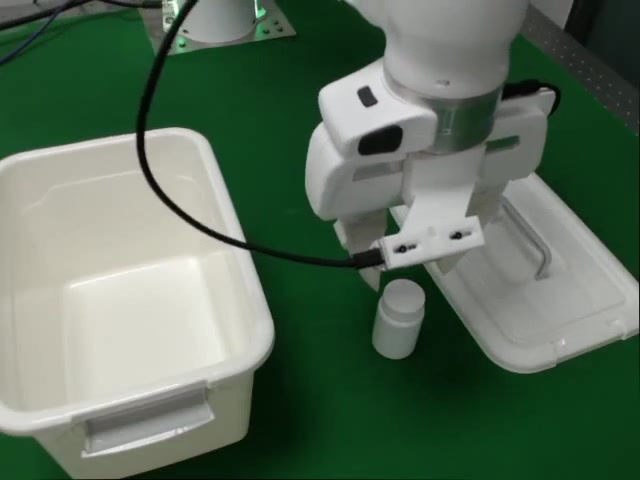
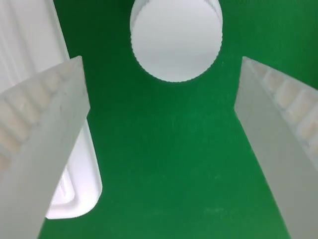
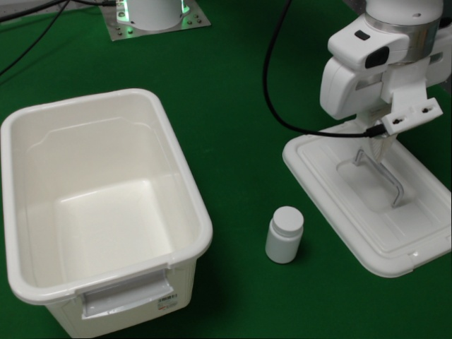
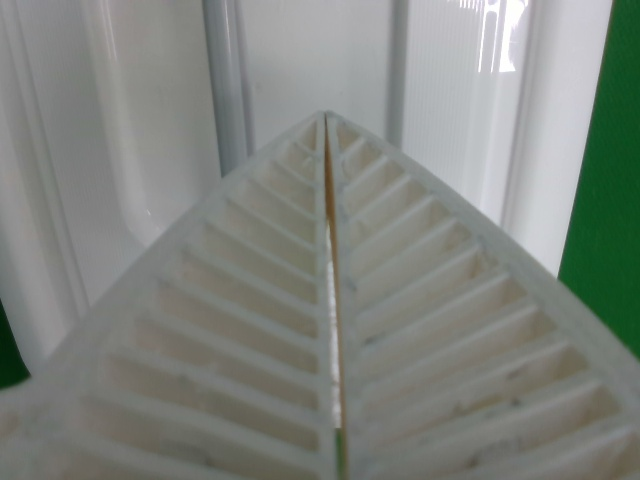

# Task3 夹爪标签错误：夹爪实际已打开，数据却记录为"关闭"（2026-11-03）

## 结论

`/mnt/82_store/vla/Franka_vr/Task3` 的 **30 条原始示范全部存在这个问题**：放下盖子后，夹爪实际已经完全打开（`gripper_width` ≈ 0.071 m），但录制的夹爪指令 `gripper_target_width` 和 `action[7]` 仍然是"关闭"（0.010）。这种状态一直持续到夹住瓶子，每条示范 **6–10 秒**。

模型用这个指令作为夹爪标签，学到的是"放下盖子后保持关闭"。真机上，Task3 P1 第 7000 步模型放下盖子后，夹爪立即在原地合上，之后一直没抓到瓶子。

**更正（同日查清根因后）**：这里有两个**独立**的错误，叠加在一起：

1. **原始指令记错**（录制当天的遥操作程序有 bug）：见下文"根因 1"。
2. **v5 训练标签也错**：v5 不读原始指令，而是按实测宽度变化方向生成标签，但阈值只有 0.007 mm，夹爪张到头后约 0.2–1 mm 的回落被当成"合上"。见"根因 2"。

两个都已修复，修正后的数据见"修复"一节。

## 任务流程（示范）

1. 夹住盖子把手，打开盖子（夹爪关闭）
2. 把盖子放到右侧（**夹爪打开**）
3. 夹爪张开，移动到瓶子上方 ← **这一段被记成了"关闭"**
4. 夹住瓶子（夹爪关闭），放进容器，盖上盖子

## 证据 1：原始数据逐帧对比（Task_3_001_cxc，30 fps）

第 578–590 帧夹爪从 0.002 m 张开到 0.071 m（松开盖子），但指令全程保持 0.010（关闭）；第 930 帧附近夹住瓶子，宽度才回落。

| frame | time (s) | gripper_width (m) | gripper_target_width | valid | action[7] |
|---|---|---|---|---|---|
| 560 | 18.7 | 0.002 | 0.010 | 1 | 0.010 |
| 566 | 18.9 | 0.002 | 0.010 | 1 | 0.010 |
| 572 | 19.1 | 0.002 | 0.010 | 1 | 0.010 |
| 578 | 19.3 | 0.027 | 0.010 | 1 | 0.010 |
| 584 | 19.5 | 0.051 | 0.010 | 1 | 0.010 |
| 590 | 19.8 | 0.071 | 0.010 | 1 | 0.010 |
| 596 | 19.9 | 0.071 | 0.010 | 1 | 0.010 |
| 602 | 20.1 | 0.071 | 0.010 | 1 | 0.010 |
| 608 | 20.3 | 0.071 | 0.010 | 1 | 0.010 |
| 614 | 20.6 | 0.071 | 0.010 | 1 | 0.010 |
| 630 | 21.1 | 0.071 | 0.010 | 1 | 0.010 |
| 690 | 23.1 | 0.071 | 0.010 | 1 | 0.010 |
| 750 | 25.1 | 0.071 | 0.010 | 1 | 0.010 |
| 810 | 27.1 | 0.071 | 0.010 | 1 | 0.010 |
| 870 | 29.1 | 0.071 | 0.010 | 1 | 0.010 |
| 930 | 31.1 | 0.016 | 0.010 | 1 | 0.010 |

## 证据 2：同一时刻的画面（Task_3_001_cxc 第 750 帧，25.1 s，指令 = 关闭）

盖子已放到右侧，夹爪张开在瓶子正上方，腕部相机里瓶盖位于两指之间。此时数据记录的夹爪指令是"关闭"。

| 外部相机（left） | 腕部相机（front） |
|---|---|
|  |  |

## 证据 3：30 条原始示范全部受影响

判定条件：指令有效、指令 < 0.03 m（关闭）、实测宽度 > 0.06 m（完全打开）。

| episode | frames | fps | contradicting frames | longest run (s) |
|---|---|---|---|---|
| Task_3_001_cxc | 2137 | 30 | 342 | 10.2 |
| Task_3_002_cxc | 2114 | 30 | 277 | 8.0 |
| Task_3_003_cxc | 2384 | 30 | 342 | 10.4 |
| Task_3_004_cxc | 2215 | 30 | 298 | 9.0 |
| Task_3_005_cxc | 1949 | 30 | 272 | 7.9 |
| Task_3_006_cxc | 2028 | 30 | 298 | 8.8 |
| Task_3_007_cxc | 2003 | 30 | 264 | 7.6 |
| Task_3_008_cxc | 1814 | 30 | 242 | 6.7 |
| Task_3_009_cxc | 1980 | 30 | 273 | 8.1 |
| Task_3_010_cxc | 1762 | 30 | 239 | 6.7 |
| Task_3_011_cxc | 1884 | 30 | 276 | 8.2 |
| Task_3_012_cxc | 2045 | 30 | 278 | 8.1 |
| Task_3_013_cxc | 1884 | 30 | 220 | 6.2 |
| Task_3_014_cxc | 1903 | 30 | 260 | 7.4 |
| Task_3_015_cxc | 2034 | 30 | 299 | 9.0 |
| Task_3_016_cxc | 1870 | 30 | 301 | 9.0 |
| Task_3_017_cxc | 1839 | 30 | 281 | 8.3 |
| Task_3_018_cxc | 1996 | 30 | 260 | 7.6 |
| Task_3_019_cxc | 2282 | 30 | 329 | 9.8 |
| Task_3_020_cxc | 2180 | 30 | 276 | 8.1 |
| Task_3_021_cxc | 2128 | 30 | 310 | 9.2 |
| Task_3_022_cxc | 1989 | 30 | 285 | 8.0 |
| Task_3_023_cxc | 2060 | 30 | 295 | 8.6 |
| Task_3_024_cxc | 2100 | 30 | 320 | 9.5 |
| Task_3_025_cxc | 2174 | 30 | 301 | 8.8 |
| Task_3_026_cxc | 2220 | 30 | 261 | 7.6 |
| Task_3_027_cxc | 2084 | 30 | 241 | 6.8 |
| Task_3_028_cxc | 2123 | 30 | 353 | 10.5 |
| Task_3_029_cxc | 2317 | 30 | 275 | 8.2 |
| Task_3_030_cxc | 2448 | 30 | 270 | 7.6 |

30/30 episodes contain a contradiction longer than 2 s

## 证据 4：处理后的训练标签同样是错的

v5 处理结果 `/data2/lyh/vla/Franka_vr_task3_v5clean_20261102/Task3/Task_3_001_cxc/data/franka_measured_eef_base_15hz_v5.npz`（与原始数据逐帧对应）：

| 帧 | gripper_target_open（标签，1=开） | 动作块夹爪标签 | state 中的实测夹爪（1=开） |
|---|---|---|---|
| 570 | 0 | 0 | 0.00 |
| 600 | 0 | 0 | 0.87 |
| 750 | 0 | 0 | 0.87 |
| 870 | 0 | 0 | 0.87 |
| 900 | 0 | 0 | 0.34（开始夹瓶子） |

v5 只在第 574–596 帧给了约 0.7 s 的"打开"，随后又回到"关闭"。模型的输入（state 里的实测夹爪 = 开）和标签（= 关）互相矛盾。

## 证据 5：真机表现与错误标签一致

模型 `task3-own-p1-7k`（ownstate 起点，Task3 P1 第 7000 步，mac_63:8110）。
日志：`/media/mac/Elements2/franka_vr_docker/logs/eef_task3_task3-own-p1-7k_20261103_152623_24083/execute/policy.jsonl`

| 动作序号 | 事件 | 位置 (m) | 实测宽度 | 说明 |
|---|---|---|---|---|
| 123–130 | 关闭 | (0.643, −0.238, 0.375) | 0.0014 | 抓盖子把手 ✅（示范此处也合到底） |
| 332–340 | 打开 | (0.649, 0.189, 0.233) | 0.071 | 把盖子放到右侧 ✅ |
| **344–350** | **关闭** | (0.649, 0.189, 0.234) | 0.0013 | **刚放下盖子，就在原地合上**（对应错误标签） |
| 370–540 | 开/合 ×5 | x 0.66→0.69, y 0.15→0.13 | 0.001–0.003 | 在盖子附近反复抓空 |

示范中瓶子的抓取点约在 x 0.72–0.76、y 0.00–0.04 m，模型始终没有往那里去。

放下盖子后第 35 帧观测：盖子在右侧，夹爪已合拢，瓶子没有被碰到。

| 外部相机 | 腕部相机 |
|---|---|
|  |  |

## 根因 1：遥操作程序把"失败的抓取"当成夹爪仍是开的（已验证）

录制当天（2026-11-01）运行的是机器人电脑上未提交的 `start_franka_vr.py`
（11-01 10:58 编译的 `__pycache__/start_franka_vr.cpython-312.pyc` 与当时源码逐函数字节码一致）。

1. 关夹爪用 Grasp(width 0.01, epsilon inner 0.01, outer 0.07)，只有最终宽度在 (0, 0.08) 内才算成功。
   盖子把手很细，夹爪合到约 0.002 m，libfranka 报 **Grasping failed**，但实际已经夹住。
2. `_gripper_goal_result` 只在成功时更新 `gripper_state`，所以程序认为夹爪**还是开的**。
3. 操作员松开握键：程序以为已经开了，**不发 OPEN**，夹爪不动。
4. 操作员再按一次：程序发 **CLOSE（发布 0.01）**，夹爪却**张开**了（硬件层原因未确认，但日志与 30 条数据一致）。
5. 录制程序如实记下 0.01，于是"放下盖子 → 抓瓶子"整段记成"关"。

遥操作日志 `/media/mac/Elements2/franka_vr_docker/logs/ros/python3_363_1793502049353.log`，示范 001（t0 = 1793503888.7）：

| 相对时间 | 日志 | 实际夹爪 |
|---|---|---|
| 9.7 s | Sending gripper CLOSE → CLOSE failed | 夹住把手 |
| 18.8 s | Sending gripper CLOSE → CLOSE failed | **张开**，放下盖子 |
| 29.5 s | Sending gripper CLOSE → completed | 夹住瓶子 |
| 42.1 s | Sending gripper OPEN → completed | 放下瓶子 |
| 55.9 s | Sending gripper CLOSE → CLOSE failed | 夹住把手 |
| 69.8 s | Sending gripper CLOSE → CLOSE failed | **张开** |

录制程序在 18.8 s 等时刻确实收到了消息（每帧的 `timestamps.gripper_target_width` 在第 561、883、2093 帧变化），值都是 0.01。
11-01 两份遥操作日志共 234 次 CLOSE failed；OPEN 只在 CLOSE 成功后出现。仓库里已提交的版本（epsilon 0.1/0.2，且无论成败都更新状态）没有这个问题。

## 根因 2：v5 的夹爪标签被张开后的微小回落翻转（已验证）

`preprocess_franka_task_measured_eef_v5.py` 设 `GRIPPER_FROM_MEASURED = True`，标签 = 实测宽度 t→t+1 的方向，阈值 1e-4（归一化，约 0.007 mm）。
夹爪张到头后宽度会回落 0.2–1 mm（001：第 596 帧 70.99 mm → 第 598 帧 70.76 mm），于是标签在张开后约 0.7 s 翻回"关"。
旧 v5 Task3 数据中 **13.5% 的帧（8363/61946）夹爪标签是错的**。其他任务的 v5 数据也用同一方法，需要单独评估（见"其他任务"）。

## 修复

**遥操作程序**（机器人电脑 `start_franka_vr.py`，未提交，备份 `~/start_franka_vr.py.bak_20261103`）：
Grasp epsilon 改为 inner = outer = 0.1；动作结束后无论成败都按请求更新 `gripper_state`（失败只记 warning）。

**录制程序**（`lerobot_episode_recorder.py`）：每条示范保存时检查指令与实测宽度。
"关指令但全开" > 1 s 或 "开指令但合着" > 1.5 s，记 ERROR，并在 `meta/episodes.jsonl` 写 `gripper_label_ok: false` 和 `gripper_label_check`（数据照常保存）。
用 11-01 前后的数据验证：Task3 30/30 被标出；Task0、Task4 各 1 条被标出，都是真实的指令/动作不一致（发 OPEN 后 2–3.4 s 夹爪才开或到结束未开）。

**数据**（mac_63 `/data2/lyh/claude_data/Franka_vr_task3_v5gripfix_20261103`；原始 NFS 与旧处理结果未改动）：

1. 从 `/mnt/82_store/vla/Franka_vr/Task3` 复制，`scripts/data_fix/fix_raw_gripper_targets.py` 只改副本：
   每条收到的夹爪消息保留原时刻，值改为之后 2 s 内夹爪实际的动作（开 0.08 / 合 0.01），同时改 30 Hz 数据和 80 Hz actions 的 `gripper_target_width` 与 `action[7]`。
   每条示范改 240–366 帧；修正后录制检查 0/30 报错，指令开合顺序与实测 30/30 一致。
2. `scripts/data_fix/preprocess_v5_gripfix.py`：v5 原流程，只把夹爪标签换成 `gripper_labels_deadband.py`
   （宽度离开最近极值 > 5 mm 才算开合，翻转点取运动开始前最后一个静止帧）。protocol / action_representation 字符串不变。
   随后 reindex 与跳变清洗照旧。窗口数 59415、手臂动作与旧数据完全一致，只有夹爪标签不同。
3. 训练：`~/claude_scripts/task3_gripfix.conf`（数据目录 `DATA_DIR`，输出 `claude_task3_gripfix_20261103`）。

## 其他任务

用 deadband 标签与实测开合对照（`scripts/data_fix/label_audit3.py`，只读）：Task0/1/2/4/5/6/40/41 对得上，剩下的差异都是示范开头夹爪本来合着、或夹爪只开/合了一半没过对照阈值（Task41 的 29 条都是张开不到 6 cm）。
旧 v5 标签在这些任务里同样会在张开后翻回"关"，影响全任务预训练数据，需要决定是否重做。

## 复现

```bash
# 只读；在任意能访问 /mnt/82_store 的服务器上运行
python scripts/check_gripper_labels.py /mnt/82_store/vla/Franka_vr/Task3
python scripts/check_gripper_labels.py /mnt/82_store/vla/Franka_vr/Task3 --frames Task_3_001_cxc:560:620:6
```
